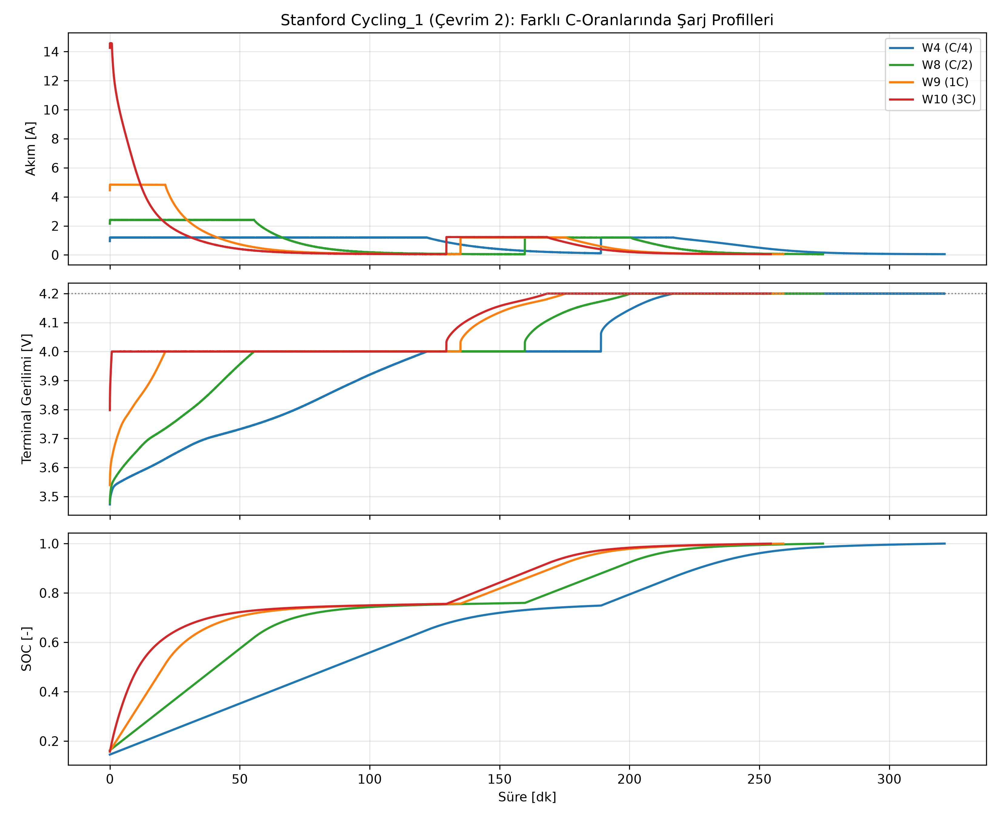
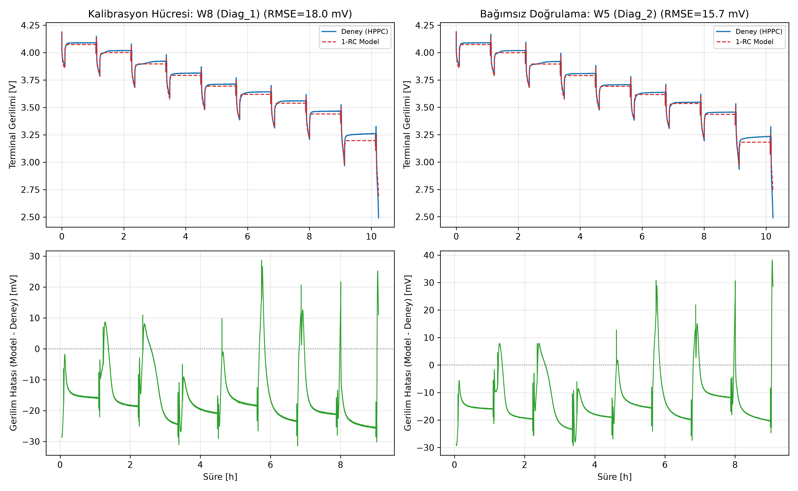
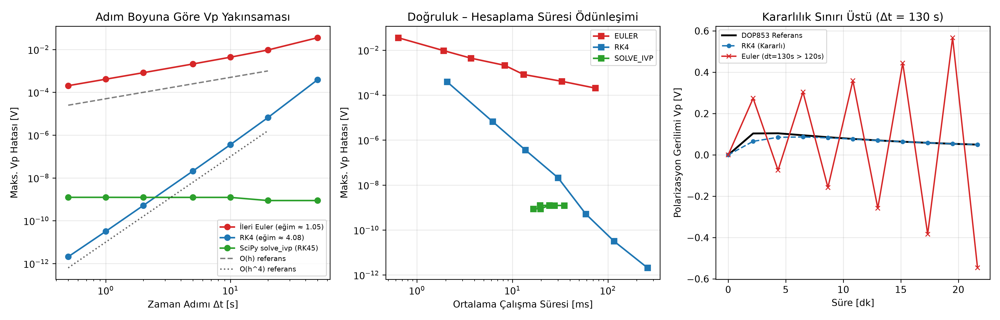
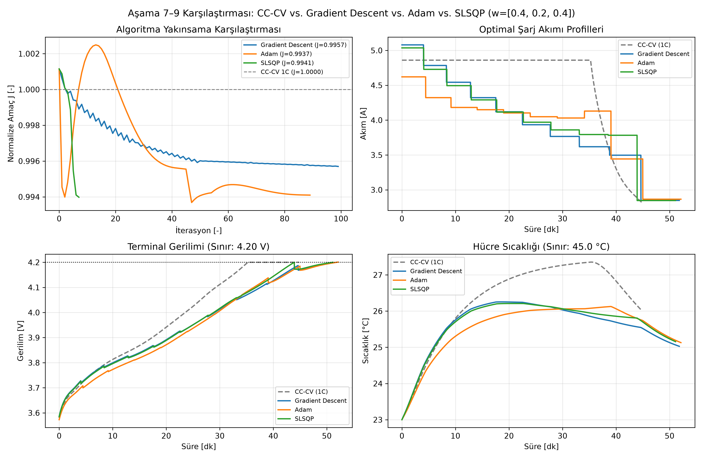
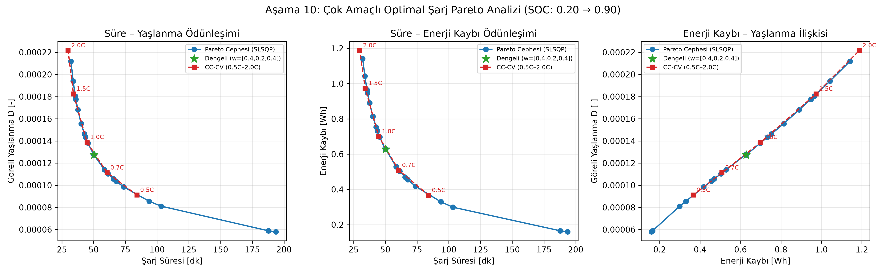
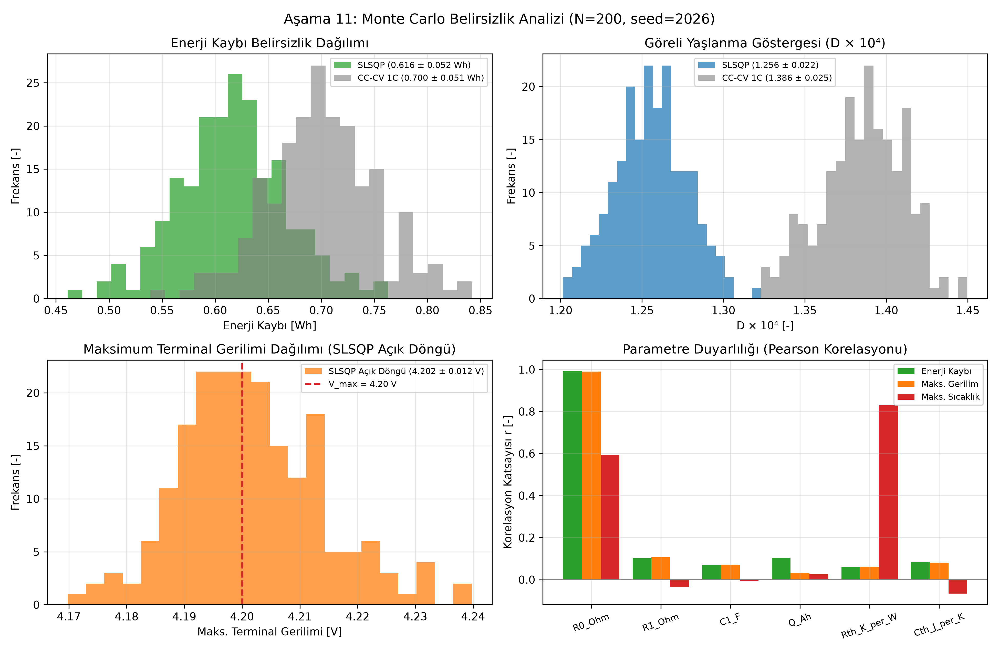

# MAT353 – Nümerik Analiz Dönem Projesi Sunumu (10 Slayt / 15 Dakika)

---

## Slayt 1 – Başlık ve Proje Künyesi *(~1 dk)*
**Elektrikli Araç Bataryalarında Çok Amaçlı Optimal Şarj Stratejisinin Nümerik Optimizasyonu**

* **Ders:** MAT353 – Nümerik Analiz (2026–2027 Güz Dönemi)
* **Bölüm:** Bilgisayar Mühendisliği – İstanbul Medeniyet Üniversitesi
* **Öğretim Üyesi:** Doç. Dr. Murat GEZER
* **Öğrenci:** Samet Oymak (24120205042)
* **Proje Türü:** Bireysel Mini Araştırma Projesi *(Veri → Model → Simülasyon → Optimizasyon → Pareto & Monte Carlo)*

---

## Slayt 2 – Problem ve Motivasyon *(~1.5 dk)*
* **Çatışan 3 Hedef:** Hızlı şarj ($t_f \downarrow$), yüksek enerji verimliliği ($E_{\text{loss}} \downarrow$), uzun batarya ömrü ($D \downarrow$).
* **Neden Geleneksel CC-CV Yetersiz?**
  * Yüksek C-oranı $\Rightarrow$ Joule ısınması ($I^2 R_0$), sıcaklık artışı ve hızlanan yaşlanma.
  * `0.5C → 2.0C` CC-CV geçişi: Şarj süresi `%64.5` kısalır ama enerji kaybı **`3.24×`** artar!
* **Amaç:** $V_t \le 4.20\text{ V}$ ve $T \le 45\ ^\circ\text{C}$ kısıtları altında $\text{SOC}: 0.20 \to 0.90$ için optimal akım profili $I(t)$ bulmak.

---

## Slayt 3 – Veri Setleri ve Ön İşleme *(~1.5 dk)*
| Özellik | Ana Veri Seti (Stanford SECL) | Yardımcı Set (NASA PCoE) |
| :--- | :--- | :--- |
| **Hücre / Kapasite** | LG INR21700-M50T (`4.85 Ah`) | 18650 (`~2.0 Ah`) |
| **Kullanılan Veriler** | `capacity_test`, `HPPC`, `EIS`, `Cycling_1` (`W4, W8, W9, W10`), `W10_Channel_6.2` (`Aux_Temp`) | `B0005, B0006, B0007, B0018` (24 °C), `B0029` (43 °C), `B0053` (4 °C) |
| **Temizlik & Ayrım** | `Step 0 / 0 V` artifaktları temizlendi; kalibrasyon (`W4,W8,W9,W10`) vs. bağımsız (`W5,V4`) ayrıldı | Tekil gerilim sıçramaları ve 6 `NaN` temizlendi; **birleştirilmedi** |

---

## Slayt 4 – Matematiksel Model ve Kalibrasyon *(~1.5 dk)*
* **Durum Vektörü:** $x(t) = [\text{SOC}(t),\; V_p(t),\; T(t),\; D(t)]^T$, kontrol $u(t) = I(t)$
$$\frac{d\text{SOC}}{dt} = \frac{\eta I}{3600Q}, \quad \frac{dV_p}{dt} = -\frac{V_p}{R_1 C_1} + \frac{I}{C_1}, \quad V_t = \text{OCV}(\text{SOC}) + I R_0 + V_p$$
$$C_{\text{th}}\frac{dT}{dt} = I^2 R_0 + \frac{V_p^2}{R_1} - \frac{T-T_{\text{amb}}}{R_{\text{th}}}, \quad \frac{dD}{dt} = k_0 e^{-\frac{E_a}{R_g T_K}}\!\left(\frac{|I|}{Q}\right)^p (1 + \alpha_{\text{soc}}\text{SOC}^2)$$
* **Kestirilen Parametreler & Bağımsız Doğrulama:**
  * $Q = 4.86\text{ Ah}$, $R_0 = 28.65\text{ m}\Omega$ (`EIS = 25.55 mΩ`), $R_1 = 15.85\text{ m}\Omega$, $C_1 = 3795\text{ F}$
  * $R_{\text{th}} = 4.25\text{ K/W}$, $C_{\text{th}} = 134.9\text{ J/K}$ (`W10` termal RMSE = **`0.16 °C`**)
  * Görülmemiş doğrulama hücreleri: `W5` RMSE = **`15.69 mV`**, `V4` RMSE = **`19.32 mV`**

---

## Slayt 5 – Optimizasyon Problemi ve Parametrizasyon *(~1.5 dk)*
* **Normalize Çok Amaçlı Amaç Fonksiyonu (Referans: 1.0C CC-CV):**
$$\min_{\mathbf{u}}\; J(\mathbf{u}) = w_1 \frac{t_f}{t_{\text{ref}}} + w_2 \frac{E_{\text{loss}}}{E_{\text{ref}}} + w_3 \frac{D(t_f)}{D_{\text{ref}}}, \qquad \sum w_i = 1$$
* **SOC-Dilimli Akım Parametrizasyonu ($N=10$ dilim, $\Delta\text{SOC} = 0.07$):**
  $$\Delta t_k = \frac{3600\, Q\, \Delta\text{SOC}_k}{\eta I_k} \implies \text{türevlenebilir } t_f(\mathbf{u})\text{ ve tam } \text{SOC}(t_f) = 0.90$$
* **Kısıtlar:** $0.50 \le I_k \le 9.72\text{ A}$, $\quad V_t(t) \le 4.20\text{ V}$, $\quad T(t) \le 45.0\ ^\circ\text{C}$

---

## Slayt 6 – Sayısal Çözücüler ve Optimizasyon Algoritmaları *(~1.5 dk)*
* **ODE Çözücüler:**
  * İleri Euler ($\mathcal{O}(h)$, ampirik `1.05`; $\Delta t > 120.3\text{ s}$'de kararsız) vs. **RK4** ($\mathcal{O}(h^4)$, ampirik `4.08`, $\Delta t=5\text{ s}$'de `2.09e-8 V`) vs. `solve_ivp`.
* **Sonlu Fark Gradyanı:** Merkezi fark için optimum adım $h^* = 10^{-5}\text{ A}$ (hata `4.12e-11`).
* **3 Optimizasyon Algoritması + Big-O:**
  1. **Gradient Descent:** Projeksiyon + Armijo adım arama + 2-kademeli ceza $\mathcal{O}(K(N+L)M)$
  2. **Adam:** Moment uyarlama ($\hat{m}, \hat{v}$) + kosinüs LR + 2-kademeli ceza $\mathcal{O}(KNM)$
  3. **SLSQP:** Doğrudan aşama kısıtlı sıralı QP $\mathcal{O}(K(NM + N^3))$

---

## Slayt 7 – Python Mimarisi ve Canlı Colab Demo Akışı *(~1.5 dk)*
* **Modüler Mimari:** `src/` (9 modül) + `tests/` (28 `pytest` testi) + `notebooks/01..10` + `EV_Battery_Optimization_Colab_Demo.ipynb`.
* **Veri Akışı:** `data_loader → preprocessing → parameter_estimation → battery_model → cc_cv → optimizers → evaluation`.
* **Canlı Demo (`EV_Battery_Optimization_Colab_Demo.ipynb`):**
  * Kalibre model yükleme $\to$ 1C CC-CV vs. GD / Adam / SLSQP canlı çalıştırma $\to$ Anlık gerilim/sıcaklık/akım grafikleri & seed=2026 Monte Carlo kontrolü (`< 20 s`).

---

## Slayt 8 – Optimizasyon Sonuçları ($w = [0.4, 0.2, 0.4]$) *(~1.5 dk)*
| Strateji | Süre $t_f$ [dk] | Kayıp $E_{\text{loss}}$ [Wh] | Yaşlanma $D \times 10^4$ | $J_{\text{toplam}}$ | $V_{\max}$ [V] | $T_{\max}$ [°C] | Süre [s] |
| :--- | :---: | :---: | :---: | :---: | :---: | :---: | :---: |
| `CC-CV (1.0C Ref)` | 44.81 | 0.700 | 1.388 | 1.0000 | 4.2000 | 27.35 | 0.49 |
| `Gradient Descent` | 51.82 | 0.609 | 1.246 | 0.9957 | 4.2001 | 26.25 | 33.72 |
| `Adam` | 52.12 | **0.600** | **1.239** | **0.9937** | 4.2008 | **26.13** | 22.57 |
| `SLSQP` | **51.11** | 0.615 | 1.257 | 0.9941 | **4.2000** | 26.21 | **1.97** |

* Tüm algoritmalar kısıtları sağladı (`feasible = True`); enerji kaybında **`%12–14`**, yaşlanmada **`%9.5–10.8`** iyileşme.
* Çoklu-seed (`42, 123, 2026`) kararlılığı: SLSQP `std = 1.96e-7`.

---

## Slayt 9 – Pareto Cephesi ve Monte Carlo Analizi *(~2 dk)*
* **Pareto (`20/20` Çözüm):** `32.14 dk` (`Eloss=1.141 Wh`) ile `193.61 dk` (`Eloss=0.160 Wh`) arasında kesintisiz ödünleşim cephesi.
* **Monte Carlo ($N=200$, `seed=2026`):**
  * **SLSQP:** $E_{\text{loss}} = 0.616 \pm 0.052\text{ Wh}$, $D = (1.257 \pm 0.025)\times 10^{-4}$
  * **CC-CV 1C:** $E_{\text{loss}} = 0.700 \pm 0.051\text{ Wh}$, $D = (1.386 \pm 0.025)\times 10^{-4}$
  * **Kritik Bulgu:** Açık döngü SLSQP'de $R_0$ belirsizliği (`r = 0.991`) nedeniyle `%45` hafif $V_{\max}$ aşımı (`4.202 ± 0.012 V`); kapalı döngü BMS gerekliliği!

|  |  |
| :---: | :---: |

---

## Slayt 10 – Sonuçlar, Sınırlamalar ve Görev Dağılımı *(~1.5 dk)*
* **Temel Kazanımlar:**
  * Doğrulanmış gerçek veri modeli (`W5/V4 < 20 mV`, `W10 = 0.16 °C`).
  * SLSQP hız ve tutarlılıkta lider (`~2 s`, `std ≈ 2e-7`); GD/Adam'a göre ~10–15× verimli.
* **Model Sınırlamaları & Gelecek Çalışma:**
  * Şarj–deşarj OCV histerezisi (`~56 mV`), lityum kaplama kısıtı ve göreli yaşlanma göstergesi $D$.
  * Emniyet paylı gürbüz optimizasyon ($V_{\max,\text{tasarım}} = 4.18\text{ V}$) ve kapalı döngü MPC.
* **Görev Dağılımı (Bireysel Proje):** Veri temini, ön işleme, parametre kestirimi, ODE/optimizasyon kodlaması, Pareto/Monte Carlo analizleri, testler (`28/28`), rapor ve sunum **Samet Oymak (24120205042)** tarafından uçtan uca geliştirilmiştir.
